# 8B Wheater — Previsão do Tempo em Pixel Art

Aplicação web de previsão do tempo desenvolvida em JavaScript puro (ES6+), CSS3 e HTML5, com interface inspirada no design de consoles portáteis clássicos (como Game Boy e Super Famicom). O sistema obtém dados meteorológicos em tempo real por meio de APIs públicas abertas, mapeia as condições atmosféricas para cenários vetoriais em pixel art (SVG) e sintetiza efeitos visuais e sonoros diretamente no navegador, sem o uso de bibliotecas externas ou frameworks pesados.

## Acesso Online

A aplicação está disponível publicamente pelo GitHub Pages:

**https://breno2274.github.io/8BWheater/**

O projeto é 100% estático e responsivo, adaptado tanto para uso em monitores desktop quanto em telas de smartphones.

---

## Galeria de Cenários

Os cenários são ilustrações vetoriais em pixel art desenhadas na proporção 16:9, alternadas dinamicamente conforme o clima e a hora local da cidade consultada:

| Dia Ensolarado | Noite Estrelada | Pôr do Sol / Entardecer |
| :---: | :---: | :---: |
|  |  |  |

| Chuva | Tempestade | Neve |
| :---: | :---: | :---: |
|  |  |  |

---

## Como o Projeto Foi Desenvolvido

O sistema foi estruturado de forma modular e independente, priorizando desempenho e compatibilidade nativa da plataforma web:

### 1. Detecção Geográfica e Geolocalização
- **Detecção automática de região**: Na primeira visita, o aplicativo identifica a cidade e estado do usuário por geolocalização de IP (GeoJS). Isso permite que qualquer visitante, de qualquer estado ou país, veja o clima da sua própria região imediatamente, sem configurações manuais.
- **GPS nativo**: O botão GPS consulta a API de geolocalização do navegador (`navigator.geolocation`) e faz a geocodificação reversa via OpenStreetMap (Nominatim) para obter o nome exato do município.
- **Persistência**: A cidade escolhida ou detectada é salva no `localStorage`, evitando que o usuário precise informar sua localização novamente em acessos futuros.

### 2. Tratamento e Normalização Meteorológica
- O consumo de dados é feito pela API pública Open-Meteo, que fornece leituras em tempo real e previsão horária/diária a partir de coordenadas geográficas.
- **Mapeamento de códigos WMO**: Converte os códigos numéricos da Organização Meteorológica Mundial em condições legíveis em português, selecionando o cenário e o ícone correspondentes.
- **Cálculo de ciclo solar**: O sistema compara o relógio local com os horários astronômicos calculados de nascer e pôr do sol. Durante a janela do crepúsculo (25 minutos antes até 20 minutos após o pôr do sol), o cenário muda automaticamente para o entardecer.
- **Precipitação e chuva**: O indicador principal avalia tanto o volume de precipitação medido quanto a probabilidade percentual de chuva para o dia, garantindo dados consistentes com a previsão estendida.

### 3. Síntese Sonora Chiptune (Web Audio API)
- Em vez de carregar arquivos pesados de áudio (MP3/WAV), todos os efeitos sonoros da interface (bips mecânicos, cliques e inicialização) são sintetizados programaticamente em tempo de execução.
- Utiliza a `AudioContext` nativa com osciladores de onda quadrada (`square`) e dente de serra (`sawtooth`), modulados por envelopes de ganho e filtros passa-baixa.
- Conta com controle de áudio (ON/OFF) com estado mantido no navegador.

### 4. Ciclo de Atualização em Tempo Real
- O aplicativo mantém um temporizador em segundo plano que consulta os dados da estação meteorológica a cada 60 segundos.
- Caso ocorra alteração na temperatura ou nas condições atmosféricas, o cenário, o gráfico horário e os sensores são atualizados automaticamente na tela, acompanhados de uma notificação visual (toast).

---

## Linguagens e Tecnologias

O projeto foi construído sem dependências de pacotes npm em produção e sem frameworks, utilizando exclusivamente padrões web:

- **HTML5**: Estrutura semântica com suporte a metadados Open Graph e atributos de acessibilidade (WAI-ARIA).
- **CSS3**:
  - Design system com estética retrô, relevos mecânicos 3D em botões e sombras chanfradas.
  - Efeitos climáticos em camadas animadas via CSS puro com `@keyframes` (pingos de chuva em perspectiva, neve flutuante, névoa e relâmpagos).
  - Folha de estilos responsiva com media queries isoladas para garantir que ajustes em dispositivos móveis não afetem a exibição em monitores desktop.
- **JavaScript (ES6+)**:
  - Código estruturado em módulos (`api.js`, `weather.js`, `audio.js`, `storage.js`, `app.js`).
  - Versão empacotada (`bundle.js`) para suportar tanto servidores web HTTP quanto a execução local via protocolo de arquivo (`file:///`).
  - Chamadas assíncronas com `fetch` e `async/await`.
- **Web Audio API**: Geração de áudio 8-bit sintetizado diretamente pelo processador do navegador.
- **SVG (Scalable Vector Graphics)**: Cenários e ícones construídos em vetores com renderização pixelada (`image-rendering: pixelated`), garantindo nitidez em resoluções Full HD, 4K e telas Retina.

---

## Design e Responsividade

O layout foi planejado para duas experiências distintas de uso:

- **Versão Desktop**: Conceito de estação console de mesa panorâmica. O centro exibe a tela do cenário climático em 16:9 com o HUD de métricas, abas superiores com botões de atalho inspirados no Super Famicom (X, Y, B, A) e uma estação lateral companheira com sensores ambientais (Índice UV, Pressão Atmosférica, Ciclo Solar e Previsão de 5 Dias).
- **Versão Mobile**: Disposição vertical empilhada em formato de console portátil. Controles de topo organizados em grade ergonômica de duas linhas, métricas rápidas agrupadas em linha única horizontal para preservar a área visível do cenário, botões táteis com dimensões mínimas adequadas para toque (36px) e barra de busca compacta sem quebra de texto.

---

## Fontes de Dados e APIs

Todas as informações são consumidas de serviços públicos abertos, sem chaves privadas expostas no código cliente:

| Serviço | Endpoint | Dados Fornecidos |
| :--- | :--- | :--- |
| **Open-Meteo Forecast** | `api.open-meteo.com/v1/forecast` | Temperatura, sensação térmica, umidade, vento, pressão, código WMO, índice UV, horários de sol e previsão diária/horária. |
| **Open-Meteo Geocoding** | `geocoding-api.open-meteo.com/v1/search` | Pesquisa de cidades e municípios mundiais com latitude e longitude. |
| **GeoJS** | `get.geojs.io/v1/ip/geo.json` | Identificação inicial da localidade do usuário com base no IP de acesso. |
| **OpenStreetMap Nominatim** | `nominatim.openstreetmap.org/reverse` | Geocodificação reversa para transformar coordenadas de GPS em nome de cidade e estado. |
| **BrasilAPI / CPTEC** | `brasilapi.com.br/api/cptec/v1` | Camada de contingência para consultas meteorológicas de municípios brasileiros. |

---

## Estrutura de Arquivos

```text
8BWheater/
├── index.html            # Estrutura principal da página
├── README.md             # Documentação técnica do projeto
├── css/
│   └── style.css         # Folha de estilos, animações e regras responsivas
├── js/
│   ├── api.js            # Integração com APIs externas de dados e geolocalização
│   ├── weather.js        # Mapeamento de códigos de tempo, chuvas e ciclo solar
│   ├── audio.js          # Síntese sonora procedural via Web Audio API
│   ├── storage.js        # Persistência de preferências no localStorage
│   ├── app.js            # Inicialização, eventos da interface e auto-atualização
│   └── bundle.js         # Código unificado para compatibilidade direta
├── img/
│   ├── cenas/            # Cenários de clima em formato SVG (16:9)
│   ├── icones/           # Ícones das condições de tempo em pixel art
│   ├── ui/               # Ícones da interface (pin, som, lupa, atualizar, etc.)
│   ├── fx/               # Efeitos gráficos atmosféricos
│   ├── logo.svg          # Logotipo vetorial
│   └── favicon.svg       # Ícone de aba do navegador
└── scripts/
    └── gerar-arte.mjs    # Script em Node.js para geração procedural dos assets vetoriais
```

---

## Como Executar Localmente

Como a aplicação é totalmente estática, você pode executá-la de duas formas:

### 1. Abertura direta no navegador
Basta abrir o arquivo `index.html` com um duplo clique ou pelo seu navegador de preferência. O arquivo `js/bundle.js` elimina bloqueios de CORS ao executar via protocolo `file:///`.

### 2. Com servidor local de desenvolvimento
Se desejar executar através de um servidor HTTP local:

```bash
# Com Node.js
npx serve .

# Ou com Python 3
python -m http.server 8080
```

Após iniciar o servidor, acesse no navegador:
`http://localhost:8080`

---

## Autor

Desenvolvido por **Breno Santana**:
- GitHub: https://github.com/breno2274
- LinkedIn: https://www.linkedin.com/in/breno-dos-santos-santana-2723a4213/
